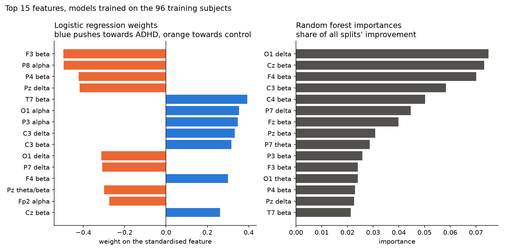
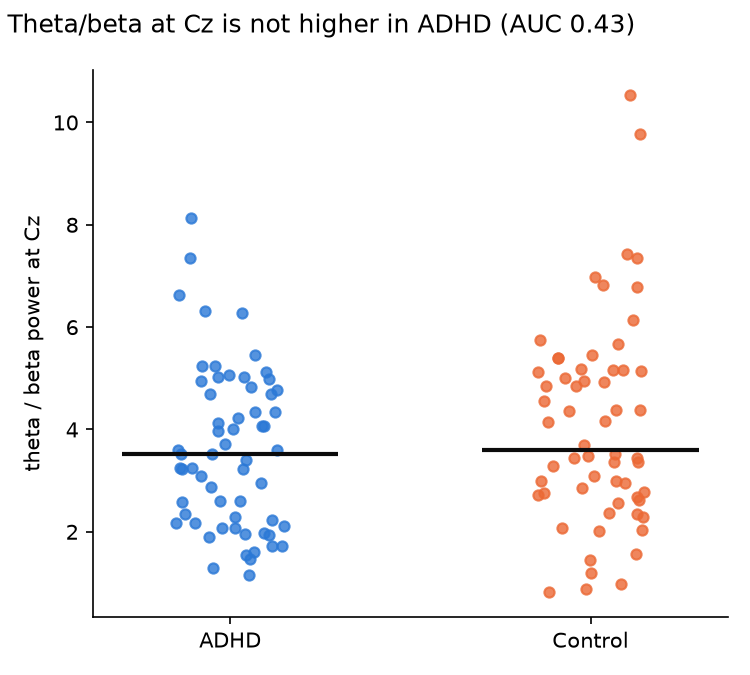
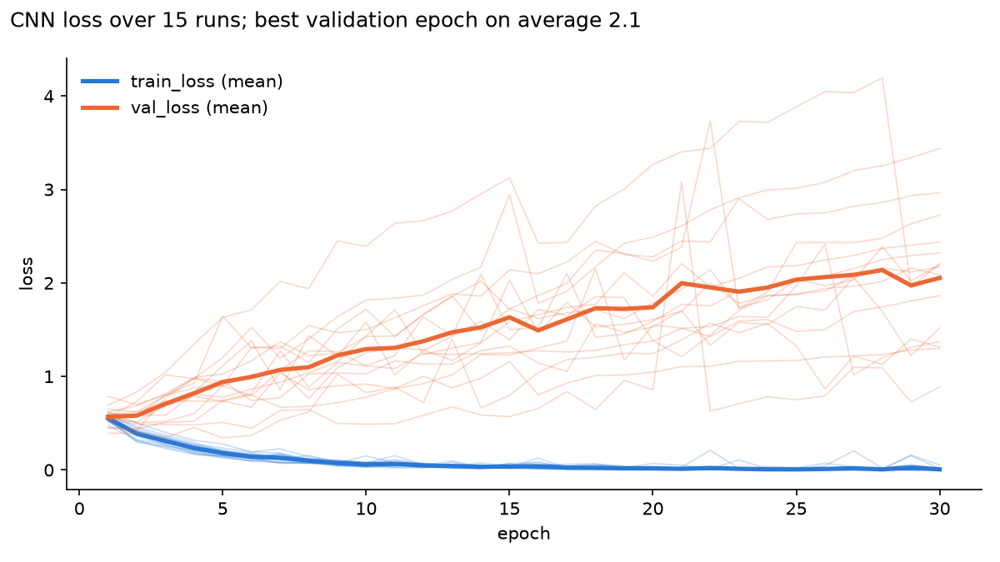

# adhd-eeg-classifier

Binarny klasyfikator, który na podstawie nagrań EEG odróżnia dzieci z ADHD od
grupy kontrolnej. Dane: 121 dzieci w wieku 7 do 12 lat (61 z ADHD, 60 bez),
19 elektrod, 128 próbek na sekundę, zbiór Kaggle `danizo/eeg-dataset-for-adhd`.
Projekt powstał jako zadanie rekrutacyjne do sekcji AI koła naukowego
KN Neuron na Politechnice Wrocławskiej.

> Wszystkie liczby poniżej pochodzą z walidacji krzyżowej na 96 dzieciach
> treningowych. Zbiór testowy (25 dzieci) nie był jeszcze użyty.

---

## W skrócie

Trzy różne modele odróżniają dzieci z ADHD od grupy kontrolnej z balanced
accuracy **0.72 do 0.78**, wyraźnie lepiej niż zgadywanie (0.50). Który model
jest najlepszy, nie da się rozstrzygnąć: różnice między nimi są mniejsze niż
rozrzut między sprawdzianami. Klasyczny wskaźnik ADHD, stosunek fal theta do
beta, na tych danych nie działa.

## Co wyszło

### Modele

Wynik na poziomie dziecka: średnie prawdopodobieństwo z jego okien, próg 0.5.
Średnia ± odchylenie z 15 sprawdzianów (5 grup dzieci, powtórzone 3 razy).

| model | balanced accuracy | ROC-AUC | czułość | swoistość |
|---|---|---|---|---|
| zawsze „ADHD” (punkt odniesienia) | 0.500 ± 0.000 | 0.500 | 1.000 | 0.000 |
| regresja logistyczna | 0.718 ± 0.091 | 0.773 | 0.758 | 0.678 |
| las losowy | 0.733 ± 0.108 | 0.790 | 0.844 | 0.622 |
| CNN 1D, okna 4 s | 0.751 ± 0.105 | 0.819 | 0.830 | 0.671 |
| **CNN 1D, okna 2 s, dropout** | **0.776 ± 0.059** | 0.813 | 0.889 | 0.664 |

- Wszystkie modele wyraźnie przebijają zgadywanie, więc w sygnale EEG jest coś,
  co odróżnia grupy.
- CNN z krótszymi oknami ma najwyższą średnią i prawie o połowę mniejszy rozrzut
  niż pozostałe (±0.06 zamiast ±0.10). Wynik najmniej zależy u niego od tego,
  które dzieci trafiły do sprawdzianu.
- Las losowy i CNN częściej mówią „ADHD”: wysoka czułość, niższa swoistość.
  Regresja logistyczna jest bardziej wyważona.
- Na poziomie pojedynczych okien wyniki są niższe (0.68 do 0.73), bo jedno okno
  niesie mniej informacji niż średnia z kilkudziesięciu.
- Dla porównania: praca na tym samym zbiorze z podziałem po osobach podaje
  ok. 0.81 accuracy lasu losowego.

Źródła: `results/classic_cv.json`, `results/classic_settings.json`,
`results/cnn_variants.json`.

### Co odróżnia grupy

- **Fale beta w środkowej i przedniej części głowy.** Las losowy opiera się na
  nich najbardziej: 47% całej ważności, głównie Cz, F4, C3, C4 i Fz.
- **Fale delta z tyłu głowy.** Grupa kontrolna ma ich więcej (AUC 0.21 do 0.30
  na Pz, P3, O1 i P7). Różnica została po filtrze i odrzuceniu artefaktów, więc
  nie wynika z mrugania ani z szumu sieci.



Źródła: `results/feature_importance.json`, `results/eda/clean_vs_raw_auc.json`.

### Czyszczenie sygnału

- Szum sieci elektrycznej 50 Hz był wyraźnie silniejszy w grupie kontrolnej.
  Bez filtra model mógłby nauczyć się rozpoznawać szum zamiast ADHD. Filtr
  0.5 do 40 Hz praktycznie go wycina, a moc w pasmach mózgowych zostaje bez zmian.
- Na surowym sygnale grupa kontrolna miała dwa razy więcej skrajnych wartości
  (`results/eda/structure.json`). Po filtrze ta różnica zniknęła, więc był to
  głównie szum sieci, a nie artefakty ruchowe. Odrzucenie okien z artefaktami
  zabiera ok. 2% danych, po równo z obu grup (pomiar opisany przy
  `ARTIFACT_FACTOR` w `src/config.py`).

## Co nie wyszło

- **Stosunek theta/beta nie odróżnia grup.** Uważany za klasyczny marker ADHD,
  tu na Cz ma AUC 0.43 (mediana 3.52 u ADHD i 3.60 w grupie kontrolnej). Na
  żadnej elektrodzie nie jest wyższy u dzieci z ADHD. To zgadza się z nowszymi
  pracami, w których ten wskaźnik jest sporny.



- **Sieć CNN szybko wykuwa dane na pamięć.** Strata walidacyjna rośnie już od
  drugiej epoki, a najlepsza epoka to średnio 2. Bez zachowania wag z najlepszej
  epoki wynik byłby dużo gorszy.



- **Dropout prawie nic nie dał.** Sieć z dropoutem i bez ma niemal identyczne
  krzywe uczenia. Pomogło dopiero skrócenie okien do 2 s.
- **Ustawienia modeli prawie nic nie zmieniają.** Sześć ustawień regresji i lasu
  różniło się o najwyżej 0.02, przy rozrzucie ±0.10. Wynik zależy od danych i
  cech, a nie od pokręteł modelu.
- **Sieć nie wygrała z prostymi modelami.** Średnio jest najlepsza, ale różnica
  mieści się w szumie. Przy 96 dzieciach sieć na surowym sygnale nie znajduje
  wyraźnie więcej niż regresja na mocy fal.

## Jak to działa

1. **Wczytanie i sprawdzenie** pliku: kolumny, braki danych, etykiety.
2. **Filtr** 0.5 do 40 Hz, osobno dla każdego dziecka, bez przesunięcia w czasie.
3. **Okna** 4 s (dla CNN także 2 s), zachodzące na siebie w połowie. Odcięte po
   2 s z początku i końca nagrania. Okna z artefaktami odrzucone progiem
   względnym do tego samego dziecka.
4. **Podział po dzieciach:** 96 do nauki, 25 do testu. Żadne dziecko nie jest
   w obu zbiorach, co sprawdzają testy.
5. **Modele:**
   - regresja logistyczna i las losowy na 95 cechach: moc w pasmach delta,
     theta, alfa i beta oraz theta/beta na każdej z 19 elektrod,
   - mała sieć CNN 1D (47 tys. wag) na surowym, przefiltrowanym sygnale.
6. **Ocena:** walidacja krzyżowa po dzieciach, balanced accuracy na poziomie
   dziecka.

## Ograniczenia

- **Mała próbka.** Efektywnie 121 dzieci. W teście jest ich 25, więc jedno źle
  sklasyfikowane zmienia wynik o 4 punkty procentowe.
- **Leki.** Dzieci z ADHD brały metylofenidat (Ritalin) do 6 miesięcy przed
  badaniem. Lek zmienia fale beta, na których najbardziej opiera się las
  losowy, więc model może częściowo rozpoznawać lek, a nie ADHD.
- **Brak wieku i płci w danych.** Młodsze dzieci mają więcej fal delta. Nie da
  się sprawdzić, czy grupy różnią się wiekiem.
- **Jeden ośrodek.** Wszystkie nagrania pochodzą z jednego szpitala w Teheranie,
  a różny poziom szumu w grupach sugeruje, że nagrywano je w trochę innych
  warunkach.
- **Nieznana jednostka sygnału.** Wartości są skwantowane co ok. 35 jednostek,
  bez podanej skali.

## Uruchomienie

```bash
uv sync
uv run python -m scripts.download_data       # pobiera adhdata.csv do data/raw/
uv run python -m scripts.explore_data         # analiza danych: struktura
uv run python -m scripts.explore_spectra      # analiza danych: fale mózgowe
uv run python -m scripts.compare_clean_bands  # różnice przed i po czyszczeniu
uv run python -m src.train_classic            # regresja i las, ok. 30 s
uv run python -m scripts.feature_importance   # ważność cech
uv run python -m src.train_cnn                # warianty CNN, ok. 6 min na GPU Maca
uv run pytest                                 # 38 testów
```

Skrypt pobierania ściąga z Kaggle archiwum 47 MB i rozpakowuje plik
`adhdata.csv` (267 MB). Jeśli w `~/.kaggle/kaggle.json` jest token API Kaggle,
`kagglehub` go użyje.

## Struktura projektu

```
src/
├── config.py            wszystkie stałe, przy każdej powód
├── data.py              wczytanie i sprawdzenie CSV, tabela dzieci
├── preprocessing.py     filtr, cięcie na okna, odrzucanie artefaktów
├── split.py             podział po dzieciach
├── features.py          moc w pasmach i theta/beta
├── evaluate.py          metryki, wynik na poziomie dziecka
├── train_classic.py     regresja i las, walidacja krzyżowa
├── train_cnn.py         uczenie i warianty CNN
├── device.py            wybór GPU / CPU
└── models/cnn.py        sieć CNN 1D
scripts/                 pobieranie danych, analiza danych, ważność cech
tests/                   38 testów
results/                 wyniki (JSON) i wykresy (PNG)
```

## Co dalej

- Jednorazowa ocena wybranych modeli na 25 dzieciach testowych.
- Sprawdzenie wpływu wieku, jeśli uda się go odzyskać z oryginalnego zbioru.
- Model łączący cechy pasmowe z surowym sygnałem.

## Źródła

Dane: A. Motie Nasrabadi i in., *EEG data for ADHD / Control children*,
IEEE DataPort, 2020. [doi:10.21227/rzfh-zn36](https://doi.org/10.21227/rzfh-zn36).
Wersja CSV: Kaggle, `danizo/eeg-dataset-for-adhd`.

Autor: [Miłosz Krawczyk](https://github.com/miloszkrawczyk).
